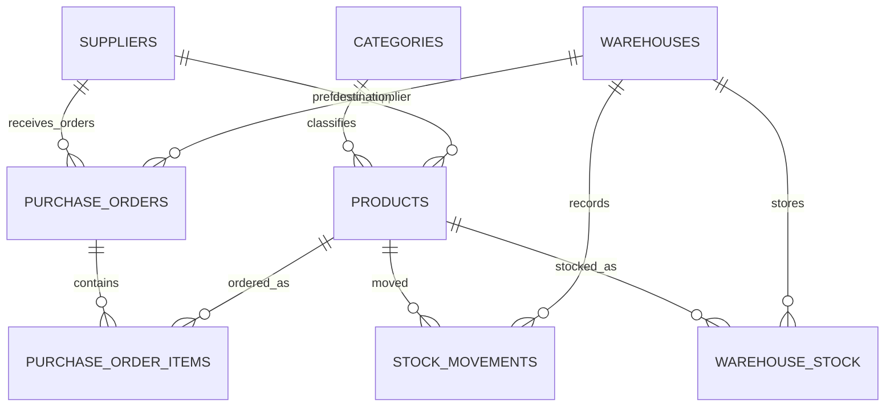

# Entity Relationship Diagram (ERD)

`warehouse_stock` uses a composite primary key `(product_id, warehouse_id)`. `purchase_order_items` is the associative entity between purchase orders and products.
