# Inventory and Warehouse Management System

> **MySQL 8.0 Capstone Project**  
> A relational database project for managing product categories, suppliers, warehouses, purchasing, inventory balances and stock movements.

## 1. Project overview

The Inventory and Warehouse Management System is designed for a distributor that stores products across multiple warehouses and purchases those products from multiple suppliers. The database keeps master data (categories, suppliers, warehouses and products), purchasing records (purchase orders and their line items), individual stock movement records, and a calculated current-stock balance for each product/warehouse pair.

The project demonstrates the main stages of a database capstone: requirements analysis, relational design, schema creation, constraints, indexing, CSV loading, SQL operations, reporting, database business rules, transactions, backup/restore planning and technical documentation.

### Main goals

- Maintain a consistent catalogue of product categories and products.
- Store supplier and warehouse information.
- Record purchase orders and the products included in each order.
- Track stock entering and leaving each warehouse.
- Calculate current stock by product and warehouse.
- Identify products that need replenishment.
- Produce supplier, warehouse, purchasing and stock-movement reports.
- Demonstrate MySQL features required by the capstone guidelines.

### Technology

| Component | Technology |
|---|---|
| Database | MySQL 8.0+ |
| Database client | MySQL Workbench / MySQL command-line client |
| Data format | CSV |
| Schema engine | InnoDB |
| Documentation diagrams | Mermaid ER diagram; native Workbench EER model to be added by the team |

## 2. Repository map

The folders are numbered in the recommended project workflow order.

| Folder | Purpose | Key contents |
|---|---|---|
| `01_Project_Overview/` | Business context and requirements | Problem statement, requirements and workflow |
| `02_Database_Design/` | Logical database design | ERD explanation, relationships and data dictionary |
| `03_Database_Schema/` | Build the database | Database, table and index scripts |
| `04_Raw_CSV_Data/` | Original input data | Seven source CSV files |
| `05_Data_Import/` | Load and validate input data | `LOAD DATA INFILE` statements and count checks |
| `06_SQL_Operations/` | Practice and demonstrate SQL | SELECT, filters, joins, aggregates, updates, deletes and subqueries |
| `07_Analytical_Reports/` | Business reporting | Report SQL and derived CSV outputs |
| `08_Views_Triggers_Transactions/` | Database business rules | Views, stock movement triggers and transaction examples |
| `09_Backup_Restore/` | Data portability | Backup and restore instructions |
| `10_Screenshots/` | Execution evidence | Owner-provided table structures and sample data screenshots |
| `11_Final_Documentation/` | Submission material | Conclusion and future improvements |

## 3. Database design and ER diagram

The schema contains eight tables. The Mermaid diagram below is rendered by GitHub directly in this README. The separate `02_Database_Design/ER_Diagram/README.md` contains the same relationship model and explanation. The project owner should also create and commit a native `.mwb` file and exported PNG from MySQL Workbench when available.

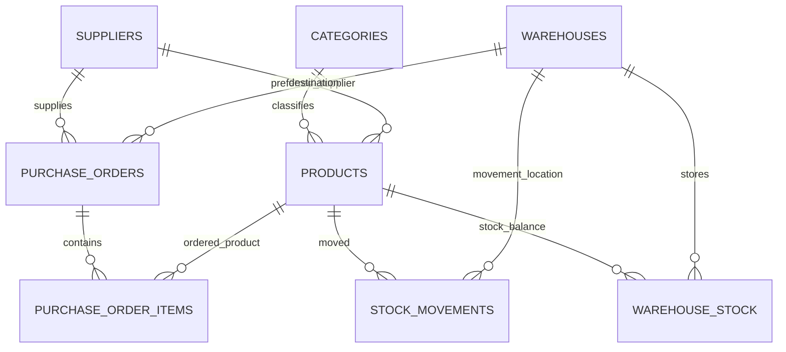

### Entity descriptions

| Table | Role | Primary key | Important relationships |
|---|---|---|---|
| `categories` | Product category master | `category_id` | One category can classify many products |
| `suppliers` | Supplier master | `supplier_id` | One supplier can be the preferred supplier for many products and can receive many purchase orders |
| `warehouses` | Warehouse master | `warehouse_id` | One warehouse can receive many purchase orders and record many stock movements/balances |
| `products` | Product catalogue and pricing | `product_id` | References a category and preferred supplier; referenced by order items, movements and stock balances |
| `purchase_orders` | Purchase order header | `purchase_order_id` | References one supplier and one destination warehouse; has many line items |
| `purchase_order_items` | Purchase order detail/line items | `purchase_order_item_id` | Connects purchase orders to products and stores ordered/received quantities and the agreed unit cost |
| `stock_movements` | Inventory movement ledger | `movement_id` | References a product and warehouse; records `IN` or `OUT` quantity movements |
| `warehouse_stock` | Current stock summary | Composite: `product_id`, `warehouse_id` | One row per product/warehouse pair; references both products and warehouses |

### Relationship explanation

1. **Categories to products (1:M):** `products.category_id` references `categories.category_id`. A category may contain multiple products, while each product belongs to one category.
2. **Suppliers to products (1:M):** `products.preferred_supplier_id` references `suppliers.supplier_id`. Each product has one preferred supplier in this design; a supplier may be preferred for many products.
3. **Suppliers to purchase orders (1:M):** each purchase order is placed with one supplier; a supplier can receive multiple purchase orders.
4. **Warehouses to purchase orders (1:M):** each purchase order identifies one destination warehouse; a warehouse can be the destination for many orders.
5. **Purchase orders to purchase order items (1:M):** one order header contains multiple product lines.
6. **Products to purchase order items (1:M):** a product may appear on many purchase order lines.
7. **Products and warehouses to stock movements (each 1:M):** each movement records exactly one product and one warehouse. Both entities can have many movement records.
8. **Products and warehouses to warehouse stock (each 1:M):** each balance row identifies one product in one warehouse. The composite primary key prevents duplicate balance rows for the same pair.

`purchase_order_items` is an associative/detail entity between purchase orders and products. `warehouse_stock` is a derived summary table; `stock_movements` is the movement ledger from which the balance can be calculated.

### ERD screenshot / Workbench model

The screenshots supplied so far show the table list, table structures and sample records. They do **not** include a confirmed graphical EER diagram. To create the native ERD in Workbench:

1. Open MySQL Workbench and connect to the project database.
2. Select **Database → Reverse Engineer**.
3. Choose the connection and the project schema.
4. Select all eight tables and complete the wizard.
5. Arrange the entities so that the foreign-key connectors are readable.
6. Save the model as `inventory_erd.mwb` in `02_Database_Design/ER_Diagram/`.
7. Use **File → Export → As PNG** (menu wording can vary by Workbench version) and save `inventory_erd.png` in the same folder.

## 4. Tables, keys and constraints

The table creation script is `03_Database_Schema/02_create_tables.sql`.

The schema uses:

- **Primary keys** to uniquely identify rows.
- **Foreign keys** to enforce valid relationships between parent and child records.
- **NOT NULL** for required attributes.
- **UNIQUE** for values such as category names, supplier emails, warehouse names and product SKUs.
- **DEFAULT** for standard values such as statuses, unit of measure, reorder level and received quantity.
- **ENUM** to restrict status and movement-type values to known options.
- **CHECK** constraints for positive prices/quantities, valid capacities, received quantity bounds and date order.
- **DECIMAL(10,2)** for monetary values rather than floating-point types.
- **DATE** for order and movement dates.

The data dictionary is available in both `02_Database_Design/data_dictionary.md` and `02_Database_Design/data_dictionary.xlsx`.

## 5. Indexing strategy

Primary keys and unique constraints create their supporting indexes automatically. InnoDB also ensures that foreign-key columns have suitable supporting indexes, creating them when required. The project adds secondary indexes for common filtering/reporting access patterns rather than blindly indexing every column.

The additional indexes defined in `03_Database_Schema/03_indexes.sql` include:

| Index | Table/column | Intended use |
|---|---|---|
| `idx_product_name` | `products(product_name)` | Product-name lookup and search |
| `idx_po_order_date` | `purchase_orders(order_date)` | Date-range purchase order reporting |
| `idx_movement_date` | `stock_movements(movement_date)` | Date-based stock movement reporting |

Use `SHOW INDEX FROM table_name;` to inspect indexes and `EXPLAIN SELECT ...;` to inspect the query plan. The optimizer may choose a table scan for small tables; that does not by itself mean an index is invalid.

## 6. Source CSV data

The `04_Raw_CSV_Data/` directory contains the original fictional input data used for the demonstration.

| Source file | Destination table | Source rows |
|---|---|---:|
| `01_categories.csv` | `categories` | 12 |
| `02_suppliers.csv` | `suppliers` | 20 |
| `03_warehouses.csv` | `warehouses` | 8 |
| `04_products_supplier_price_list.csv` | `products` | 60 |
| `05_purchase_orders.csv` | `purchase_orders` | 25 |
| `06_purchase_order_items.csv` | `purchase_order_items` | 50 |
| `07_stock_movements.csv` | `stock_movements` | 150 |
| **Total** | | **325** |

All names, contact details and business records in the supplied datasets are fictional demonstration data. The source CSV files are retained separately from analytical output CSV files so that raw inputs are not overwritten by reports.

## 7. Environment setup and database rebuild

### Requirements

- MySQL Server 8.0 or later.
- MySQL Workbench or a MySQL command-line client.
- Access to a directory readable by the MySQL server for server-side `LOAD DATA INFILE`.
- Permission to write exported files to the MySQL server's permitted output directory.

### Important schema-name consistency

The SQL scripts in this repository currently create and use the schema named **`inventory_db`**. Some screenshots supplied by the project owner display the schema name **`inventory_management`**. The screenshots have been retained as supplied; they have not been altered. For a clean rebuild, use `inventory_db` consistently, or deliberately change the schema name in every relevant SQL script before execution. Do not mix the two names in one run.

### Recommended rebuild sequence

1. Review `01_Project_Overview/` and the design files.
2. Execute `03_Database_Schema/01_create_database.sql`.
3. Execute `03_Database_Schema/02_create_tables.sql`.
4. Copy all seven CSV files from `04_Raw_CSV_Data/` into the MySQL server's permitted import directory.
5. Update the file paths in `05_Data_Import/csv_import_queries.sql` for your computer.
6. Execute the import statements in parent-before-child order: categories, suppliers, warehouses, products, purchase orders, purchase order items, stock movements.
7. Execute `05_Data_Import/import_verification.sql` and compare the row counts with the source table above.
8. Initialize `warehouse_stock` from the historical movement ledger using the query below, if it has not already been initialized.
9. Execute `03_Database_Schema/03_indexes.sql` (skip any index that already exists).
10. Run the SQL operations and analytical report queries.
11. Review and execute views, triggers and transaction examples only after understanding their effects and validating the stock balance.
12. Perform backup/restore testing and add your own execution evidence screenshots.

### Import ordering rationale

Parent/master tables must be loaded before child/transaction tables because foreign-key constraints require referenced rows to exist. The correct sequence is categories, suppliers, warehouses, products, purchase orders, purchase order items and stock movements. `warehouse_stock` is a derived table and is initialized from stock movements rather than loaded from one of the seven source CSV files.

### Example server-side CSV import

The import script contains the full statements. A representative statement is:

```sql
LOAD DATA INFILE
'C:/ProgramData/MySQL/MySQL Server 8.0/Uploads/01_categories.csv'
INTO TABLE categories
FIELDS TERMINATED BY ','
OPTIONALLY ENCLOSED BY '"'
LINES TERMINATED BY '\r\n'
IGNORE 1 LINES
(category_id, category_name, description);
```

`LOAD DATA INFILE` reads from the MySQL server's filesystem. `LOAD DATA LOCAL INFILE` reads from the client machine and has separate client/server configuration requirements. Check `secure_file_priv` and `local_infile` if the import is rejected. The line terminator must match the actual CSV file format (`\r\n` for CRLF or `\n` for LF).

## 8. Initializing `warehouse_stock`

The raw input includes historical `IN` and `OUT` stock movements. The current balance is calculated by adding incoming quantities and subtracting outgoing quantities for each product/warehouse pair.

Run this **once**, after importing the movement CSV and before installing the `AFTER INSERT` stock-maintenance trigger:

```sql
INSERT INTO warehouse_stock
    (product_id, warehouse_id, quantity_on_hand)
SELECT
    product_id,
    warehouse_id,
    SUM(CASE
        WHEN movement_type = 'IN' THEN quantity
        WHEN movement_type = 'OUT' THEN -quantity
    END) AS calculated_balance
FROM stock_movements
GROUP BY product_id, warehouse_id
HAVING calculated_balance >= 0;
```

Verify the results:

```sql
SELECT COUNT(*) AS stock_balance_rows FROM warehouse_stock;

SELECT
    product_id,
    warehouse_id,
    quantity_on_hand
FROM warehouse_stock
ORDER BY warehouse_id, product_id;
```

**Do not run the initialization INSERT repeatedly.** It is not an upsert and will conflict with the composite primary key if the balances are already present. Also do not replay historical movement imports after installing the movement trigger, because the trigger would apply those movements again and double-count the balances.

## 9. SQL operations and learning coverage

The `06_SQL_Operations/` directory groups the practice queries by topic.

| SQL topic | What it demonstrates | Where to look |
|---|---|---|
| Basic SELECT and WHERE | Selecting columns, filtering records | `01_basic_select.sql` |
| JOINs | Combining related entities using keys | `02_joins.sql` |
| Aggregates | COUNT, SUM, AVG and grouped summaries | `03_aggregates.sql` |
| UPDATE and DELETE | Controlled data modification using key-based filters | `04_update_delete.sql` |
| Subqueries and EXPLAIN | Nested queries and query-plan inspection | `05_subqueries_and_explain.sql` |

Run the SELECT preview for an UPDATE or DELETE condition before applying the modification. Be especially careful with DELETE operations because they permanently remove rows and may be restricted by foreign keys.

## 10. Analytical reports and exported CSVs

The report query files are in `07_Analytical_Reports/sql_queries/`. The corresponding example CSV outputs are in `07_Analytical_Reports/exported_csv/`.

| Report | Analysis | Output file |
|---|---|---|
| Warehouse stock balances | Current units by product and warehouse | `00_warehouse_stock_balances.csv` |
| Warehouse valuation | Cost value and potential selling value by warehouse | `01_warehouse_valuation.csv` |
| Low-stock report | Products at or below reorder level | `02_low_stock_report.csv` |
| Supplier purchase analysis | Order counts, quantities and purchase value by supplier | `03_supplier_purchase_report.csv` |
| Monthly movement analysis | Monthly IN, OUT and net movement quantities | `04_monthly_movement_report.csv` |
| Purchase order detail | Supplier, warehouse, product and order-line details | `05_purchase_order_report.csv` |

The supplied report CSVs are example outputs calculated from the fictional source dataset using equivalent relational calculations. They are not represented as screenshots or exports captured from the owner's local Workbench session. To generate fresh database exports, execute the corresponding SQL query and append an `INTO OUTFILE` clause with a new filename. MySQL will not overwrite an existing output file; remove or rename an old file before exporting again.

Example export format:

```sql
SELECT product_id, product_name
FROM products
ORDER BY product_name
INTO OUTFILE
'C:/ProgramData/MySQL/MySQL Server 8.0/Uploads/product_list.csv'
FIELDS TERMINATED BY ','
OPTIONALLY ENCLOSED BY '"'
LINES TERMINATED BY '\r\n';
```

## 11. Views, triggers and transactions

The `08_Views_Triggers_Transactions/` directory contains scripts for the business-rule phase.

- **Views:** reusable query definitions for commonly requested reports. Review the view definitions and test them with SELECT statements after creation.
- **BEFORE trigger:** intended to validate an outgoing stock movement before it is inserted, including checking that the requested quantity does not exceed available stock.
- **AFTER trigger:** intended to update the corresponding `warehouse_stock` balance when a new stock movement is inserted.
- **Transactions:** demonstrate a multi-step operation that is committed as a unit, and a separate operation that is rolled back. A stock transfer is a useful example because it requires a source-warehouse decrease and destination-warehouse increase.

### Trigger installation sequence

1. Import historical stock movements.
2. Populate and verify `warehouse_stock` from those historical movements.
3. Install the BEFORE and AFTER movement triggers.
4. Test with a new movement using a transaction and verify the resulting balance.
5. Do not re-import the original historical movement file after trigger installation.

Triggers and transactions change data. Read the scripts before executing them, test on a development copy, and verify the expected before/after balance.

## 12. Backup and restore

See `09_Backup_Restore/backup_restore.md` for the backup and restore procedure. The capstone deliverable should include a full SQL backup created using MySQL Workbench Data Export or `mysqldump`, plus evidence that the backup can be restored into a test schema. A backup file is not considered verified until a restore test has succeeded.

## 13. Screenshot evidence

Screenshots supplied by the project owner are stored under `10_Screenshots/`. The evidence index is `10_Screenshots/SCREENSHOT_INDEX.md`.

### Database/table-list evidence


### Table structure evidence

The following captures show the table definitions as displayed by the MySQL client. Open each image for the full-size capture.

| Table | Screenshot |
|---|---|
| `categories` | [View structure](10_Screenshots/table_structures/02_categories_table_structure.png) |
| `products` | [View structure](10_Screenshots/table_structures/03_products_table_structure.png) |
| `purchase_order_items` | [View structure](10_Screenshots/table_structures/04_purchase_order_items_table_structure.png) |
| `purchase_orders` | [View structure](10_Screenshots/table_structures/05_purchase_orders_table_structure.png) |
| `stock_movements` | [View structure](10_Screenshots/table_structures/06_stock_movements_table_structure.png) |
| `suppliers` | [View structure](10_Screenshots/table_structures/07_suppliers_table_structure.png) |
| `warehouse_stock` | [View structure](10_Screenshots/table_structures/09_warehouse_stock_table_structure.png) |
| `warehouses` | [View structure](10_Screenshots/table_structures/10_warehouses_table_structure.png) |

### Sample data evidence

| Table | Screenshot |
|---|---|
| `categories` | [View sample rows](10_Screenshots/query_outputs/01_categories_data.png) |
| `products` | [View sample rows](10_Screenshots/query_outputs/02_products_data.png) |
| `purchase_order_items` | [View sample rows](10_Screenshots/query_outputs/03_purchase_order_items_data.png) |
| `purchase_orders` | [View sample rows](10_Screenshots/query_outputs/04_purchase_orders_data.png) |
| `stock_movements` | [View sample rows](10_Screenshots/query_outputs/05_stock_movements_data.png) |
| `suppliers` | [View sample rows](10_Screenshots/query_outputs/06_suppliers_data.png) |
| `warehouse_stock` | [View sample rows](10_Screenshots/query_outputs/07_warehouse_stock_data.png) |
| `warehouses` | [View sample rows](10_Screenshots/query_outputs/08_warehouses_data.png) |

These are the screenshots currently provided. They document the visible schema/table list, table structures and sample records. Additional evidence should be added after the team executes and verifies indexes, CSV imports, analytical reports, views, triggers, transactions and backup/restore. The repository does not claim that screenshots exist for operations not yet captured.

## 14. Capstone checklist

| Requirement | Project artifact | Status guidance |
|---|---|---|
| Problem statement and requirements | `01_Project_Overview/` | Included |
| ER design and relationships | `02_Database_Design/` | Mermaid ERD and explanation included; native Workbench `.mwb`/PNG should be generated by team |
| 5+ tables, keys and constraints | `03_Database_Schema/` | Eight-table schema script included |
| Indexes | `03_Database_Schema/03_indexes.sql` | Script included; verify on target database |
| 8+ rows per main table / 30+ overall | `04_Raw_CSV_Data/` | Source files contain 325 rows in total; verify successful import |
| SELECT and join operations | `06_SQL_Operations/` | Query scripts included; capture actual outputs |
| UPDATE and DELETE | `06_SQL_Operations/04_update_delete.sql` | Examples included; execute carefully on a test copy |
| Two or more views | `08_Views_Triggers_Transactions/views.sql` | Script included; execute and test |
| BEFORE and AFTER triggers | `08_Views_Triggers_Transactions/triggers.sql` | Script included; install after stock initialization and test |
| COMMIT and ROLLBACK | `08_Views_Triggers_Transactions/transactions.sql` | Examples included; execute and capture evidence |
| CSV import/export | `05_Data_Import/` and `07_Analytical_Reports/` | Import scripts and example report outputs included; perform local export |
| Backup and restore | `09_Backup_Restore/` | Instructions included; add actual backup and restore evidence |
| Documentation and viva | This README and `11_Final_Documentation/` | Documentation starter files included; complete with team-specific results |

## 15. Group contribution workflow

For collaborative work, use separate branches and pull requests rather than having every member edit `main` directly.

```bash
git clone https://github.com/<YOUR-ORG-OR-USERNAME>/Inventory-Warehouse-Management.git
cd Inventory-Warehouse-Management
git checkout -b feature/report-or-task-name

# Edit or add the assigned files
git add .
git commit -m "Add warehouse inventory report"
git push origin feature/report-or-task-name
```

Open a Pull Request on GitHub, describe the change, and ask another group member to review the SQL and output before merging. Avoid committing passwords, local connection settings or private credentials.

## 16. Known limitations and next steps

- The native MySQL Workbench `.mwb` EER file must be generated from the team's live schema; the Mermaid diagram in this README is the portable documented ERD.
- The screenshot evidence supplied so far does not include every project phase. Add genuine screenshots as each phase is executed.
- Confirm the schema name (`inventory_db` versus `inventory_management`) and use one consistently.
- Confirm that the current `warehouse_stock` balances match the stock movement ledger before enabling triggers.
- Run all SQL scripts in a fresh test schema before final submission; scripts may need minor path or environment adjustments for a different MySQL installation.
- Replace example analytical outputs with newly exported outputs from the final verified database if the evaluator expects direct Workbench exports.

## 17. Conclusion

This project provides an end-to-end relational database design for a small distributor's inventory and warehouse workflow. It connects product master data, supplier purchasing, warehouse locations and stock movement history, then uses SQL queries and report exports to support stock visibility and purchasing analysis. The included scripts and fictional CSV data provide a reproducible starting point for the group to execute, validate, extend and document the final capstone submission.
## MySQL Workbench screenshot evidence

The following images are embedded directly in this README. On GitHub, each image will render inline. The original full-resolution files are also retained in `10_Screenshots/` for download and reuse.

### Database creation

**Database and table listing**


### Table structures

**Categories table structure**

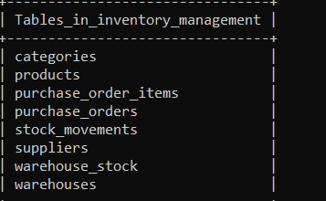

**Products table structure**

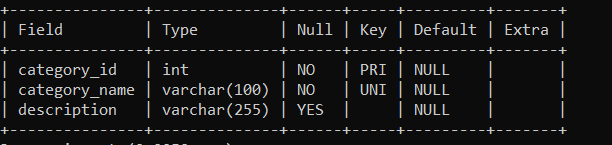

**Purchase order items table structure**

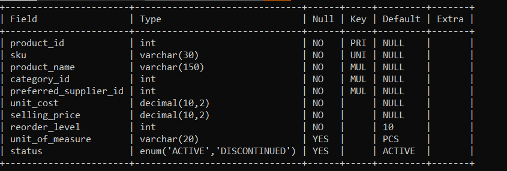

**Purchase orders table structure**

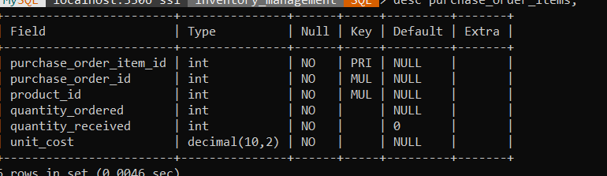

**Stock movements table structure**

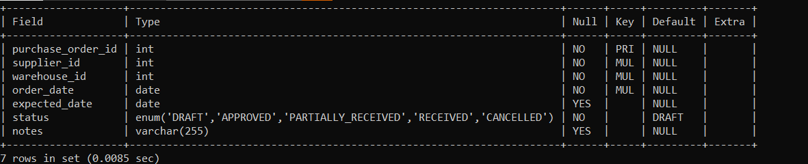

**Suppliers table structure**

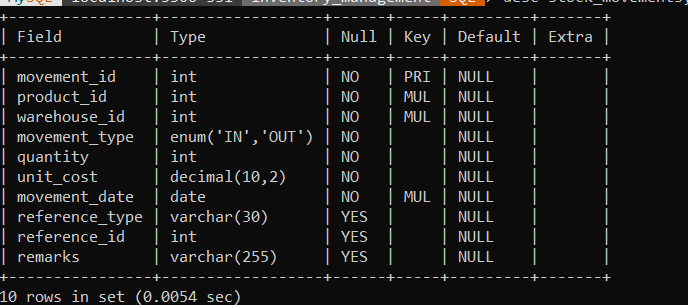

### Query outputs and sample data

**Category records**

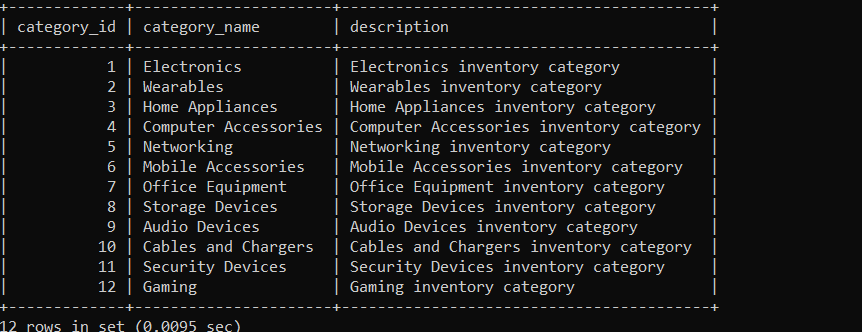

**Product records**

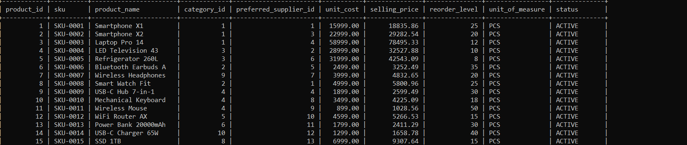

**Purchase order item records**

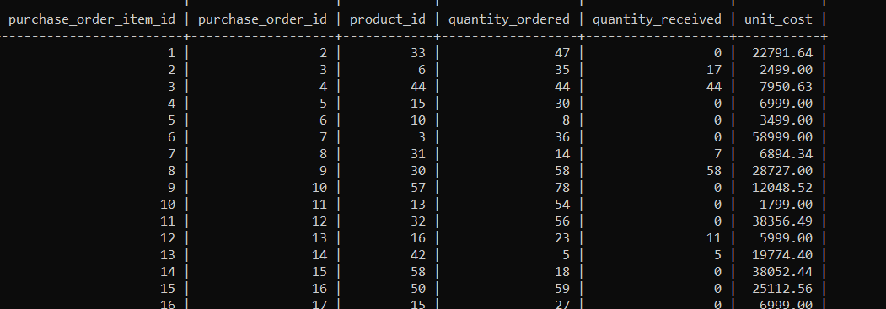

**Purchase order records**

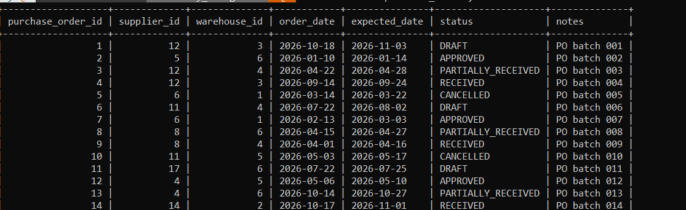

**Stock movement records**

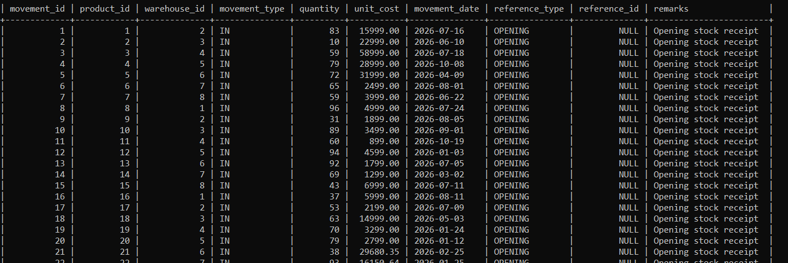

**Supplier records**

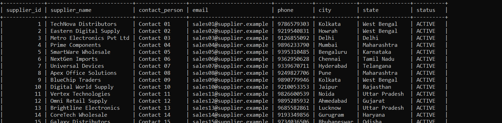

**Warehouse stock balances**

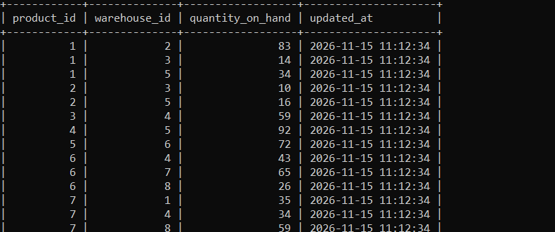

**Warehouse records**

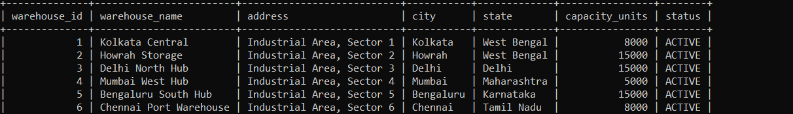

### Evidence still to be captured

The screenshots supplied so far document database/table listing, table structures and sample table data. Add genuine Workbench screenshots here after executing and verifying indexing, CSV imports/exports, analytical reports, views, triggers, transactions and backup/restore. These are intentionally not represented by mock screenshots.

### Schema-name consistency note

The supplied terminal screenshots visibly show `inventory_management`, while the current SQL scripts use `inventory_db`. Before a clean end-to-end run, choose one schema name and update all `CREATE DATABASE`, `USE`, import and report scripts consistently.
